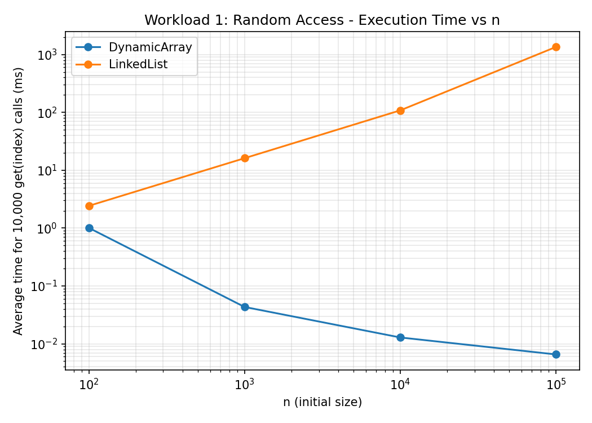
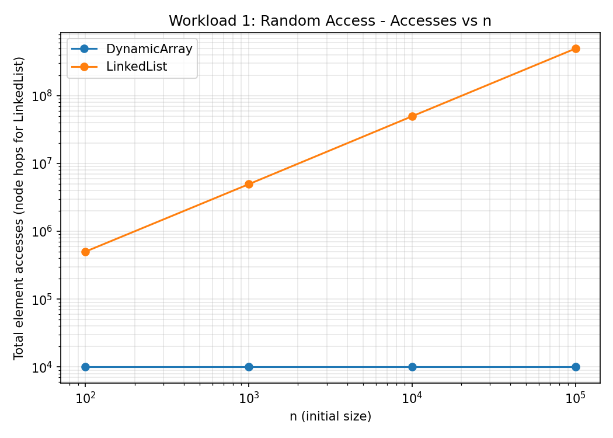
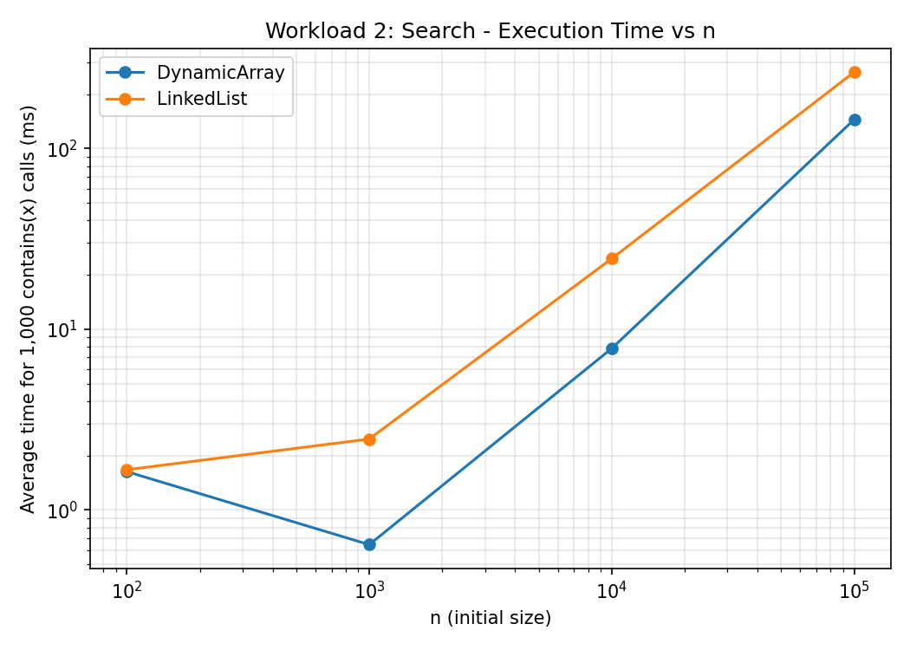
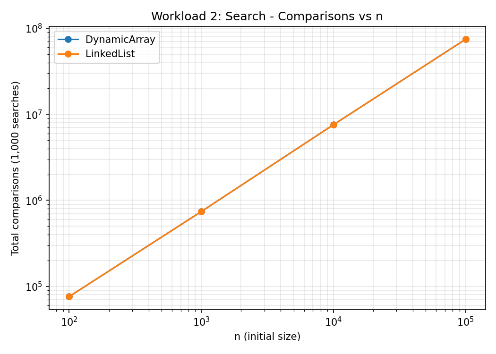
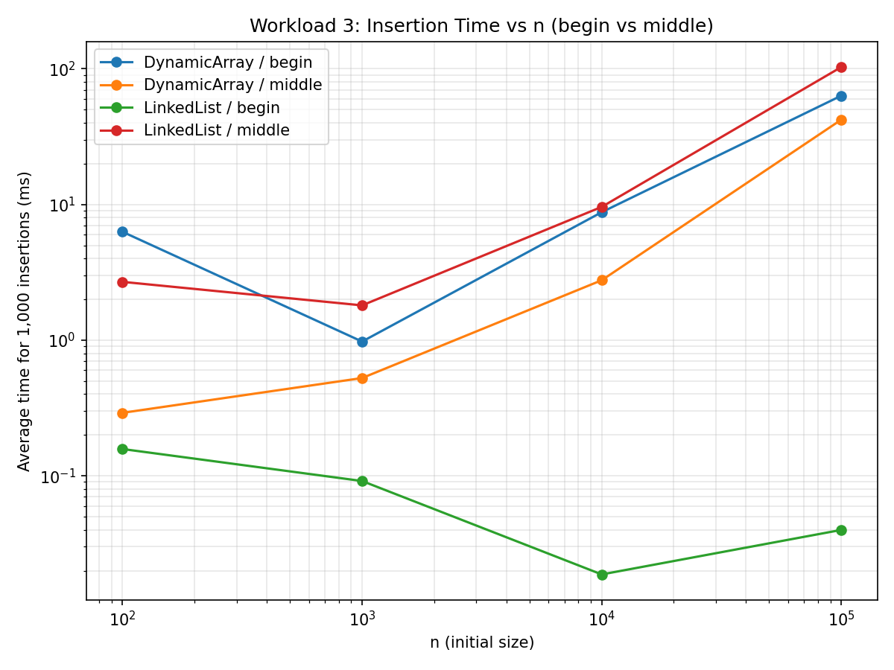
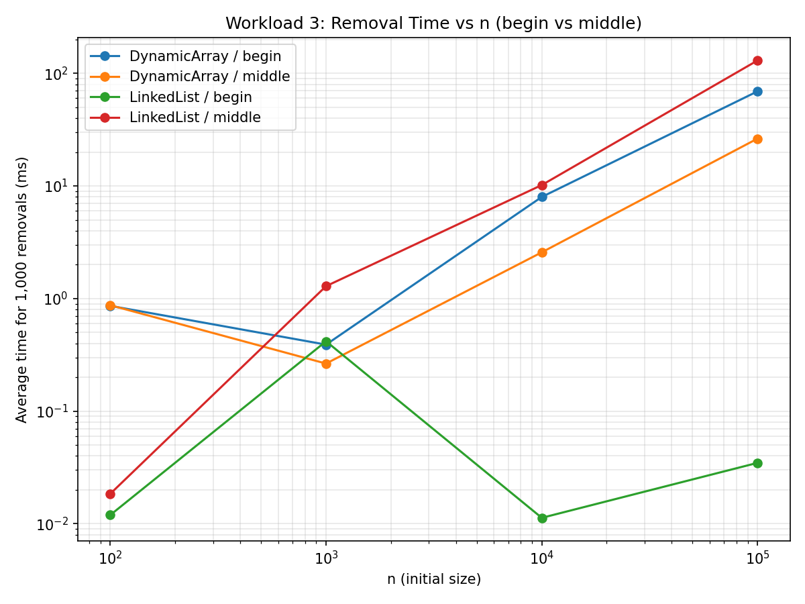
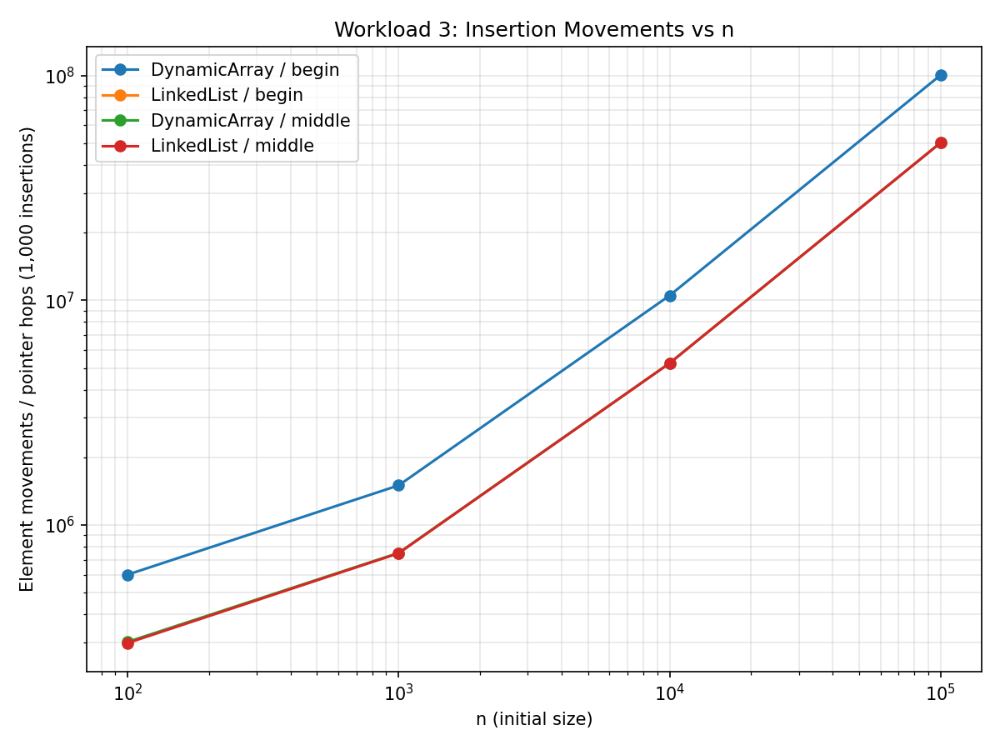
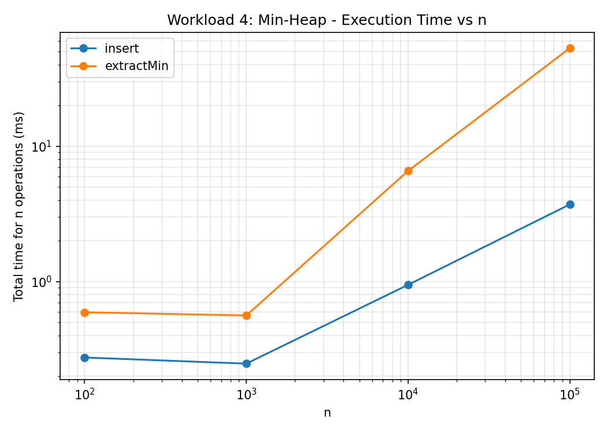
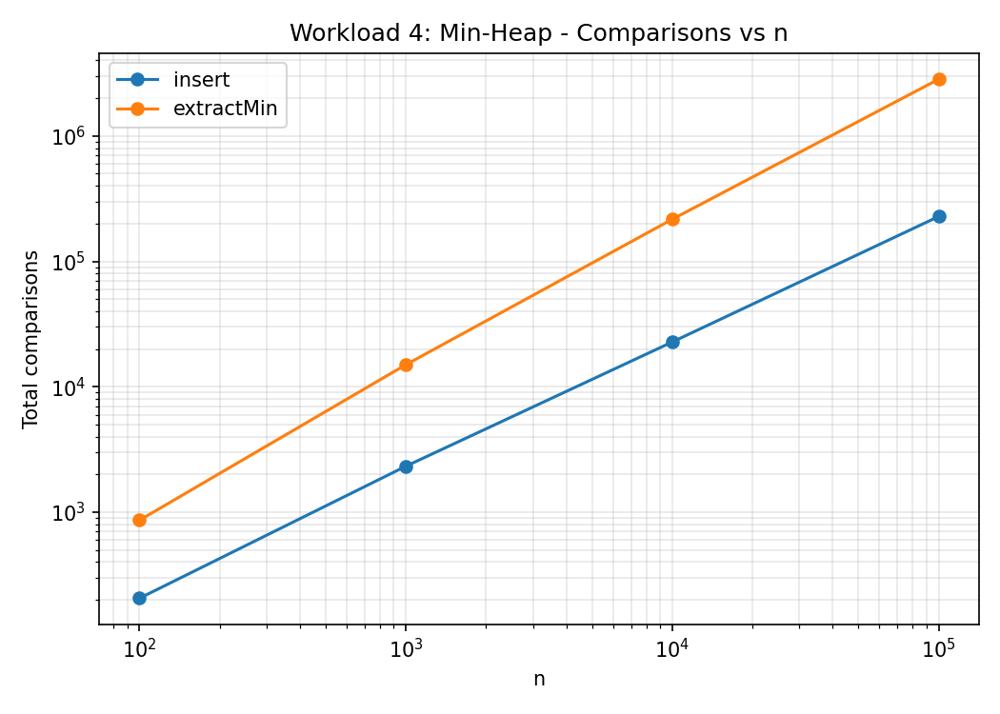

# Assignment 2 — Algorithmic Analysis, Correctness and Performance Trade-offs

**Автор:** индивидуальная работа
**Язык реализации:** Java 21
**Дата:** сентябрь 2026

Репозиторий содержит собственные (написанные с нуля) реализации трёх структур
данных — Dynamic Array, Linked List и Min-Heap, — их корректностные доказательства,
теоретический анализ сложности и результаты экспериментального бенчмаркинга.

```
assignment-2/
├── src/
│   ├── DynamicArray.java
│   ├── LinkedList.java
│   ├── MinHeap.java
│   ├── Benchmark.java
│   └── Tests.java
├── scripts/
│   └── make_plots.py
├── results/
│   ├── tables/   (*.csv — сырые результаты замеров)
│   └── plots/    (*.png — графики)
└── README.md
```

---

## 1. Overview

Цель задания — не просто реализовать три классические структуры данных
(Dynamic Array, Linked List, Min-Heap), а провести полноценный анализ их
алгоритмов: доказать корректность через инварианты цикла, определить
теоретическую асимптотику по всем операциям (O, Ω, Θ), спроектировать
контролируемые эксперименты и сравнить теорию с реально измеренной
производительностью на JVM.

Реализованы:

- **DynamicArray\<T\>** — на основе `Object[]`, с удвоением капасити при
  переполнении (`add`, `add(index,x)`, `remove(index)`, `get(index)`, `contains(x)`).
- **LinkedList\<T\>** — односвязный список с хвостовым указателем (свой класс,
  не `java.util.LinkedList`), та же сигнатура операций.
- **MinHeap\<T extends Comparable\<T\>\>** — бинарная min-куча на массиве
  (`insert`, `peekMin`, `extractMin`).

Каждый класс содержит встроенные счётчики (`accessCount`, `comparisonCount`,
`movementCount`), которые позволяют измерять не только время выполнения
(`System.nanoTime()`), но и точное число элементарных операций — это нужно,
чтобы отделить эффект константных факторов JVM от собственно алгоритмической
сложности.

---

## 2. Complexity Analysis

### 2.1 Сводная таблица

| Структура     | Операция         | Best        | Average     | Worst       | Aux. space |
|---------------|------------------|-------------|-------------|-------------|------------|
| DynamicArray  | `add(x)`         | Θ(1)*       | Θ(1)* (amortized) | O(n) (resize) | O(1) amortized / O(n) при resize |
| DynamicArray  | `add(index,x)`   | Ω(1) (index=size) | Θ(n)  | O(n) (index=0) | O(1) |
| DynamicArray  | `remove(index)`  | Ω(1) (index=size-1) | Θ(n) | O(n) (index=0) | O(1) |
| DynamicArray  | `get(index)`     | Θ(1)        | Θ(1)        | Θ(1)        | O(1) |
| DynamicArray  | `contains(x)`    | Ω(1) (найден первым) | Θ(n) | O(n) (не найден) | O(1) |
| LinkedList    | `add(x)` (append)| Θ(1)        | Θ(1)        | Θ(1)        | O(1) |
| LinkedList    | `add(index,x)`   | Ω(1) (index=0 или size) | Θ(n) | O(n) (index≈size/2) | O(1) |
| LinkedList    | `remove(index)`  | Ω(1) (index=0) | Θ(n)     | O(n)        | O(1) |
| LinkedList    | `get(index)`     | Ω(1) (index=0) | Θ(n)     | O(n) (index=size-1) | O(1) |
| LinkedList    | `contains(x)`    | Ω(1)        | Θ(n)        | O(n)        | O(1) |
| MinHeap       | `insert(x)`      | Ω(1)        | Θ(log n)    | O(log n)    | O(1) |
| MinHeap       | `peekMin()`      | Θ(1)        | Θ(1)        | Θ(1)        | O(1) |
| MinHeap       | `extractMin()`   | Ω(1) (n≤1)  | Θ(log n)    | O(log n)    | O(1) |

\* `add(x)` у Dynamic Array — Θ(1) **амортизированно**: отдельная вставка при
resize стоит O(n), но так как resize (удвоение) происходит экспоненциально
редко, суммарная стоимость n добавлений равна O(n), т.е. O(1) на операцию
в среднем (метод бухгалтерского учёта / amortized analysis).

### 2.2 Обоснование

**DynamicArray.add(x)** — если есть свободное место, это присваивание
`data[size]=x; size++` — Θ(1). Если массив заполнен, нужно выделить новый
массив вдвое большего размера и скопировать n элементов — O(n). Поскольку
удвоение случается только когда размер становится степенью двойки от
исходной ёмкости, суммарная стоимость n последовательных `add` равна
n + (1+2+4+...+n) ≈ 3n, то есть амортизированная стоимость одной операции —
Θ(1).

**DynamicArray.add(index,x) / remove(index)** — корректность требует сдвига
всех элементов после `index` на одну позицию, чтобы сохранить порядок и
плотную упаковку массива. Число сдвигаемых элементов — `size - index`.
При `index=size` (append) сдвигать нечего → Ω(1). При `index=0` сдвигаются
все `size` элементов → O(n). В среднем по случайному индексу — Θ(n) (мат.
ожидание n/2 сдвигов).

**DynamicArray.get(index)** — прямой доступ по индексу к непрерывному блоку
памяти, `data[index]` — единственная операция независимо от `index` и `size`
→ Θ(1) во всех случаях. Это ключевое структурное преимущество массива.

**DynamicArray.contains(x)** — линейный проход, в худшем случае (элемент
отсутствует или находится в конце) — n сравнений, O(n); в лучшем — элемент
первый, Ω(1); в среднем при равномерном распределении позиции — Θ(n).

**LinkedList.add(x)** (append) — благодаря хранению указателя `tail`,
присоединение нового узла — это релинковка двух ссылок, Θ(1), **без**
обхода списка. Без tail-указателя эта операция была бы O(n).

**LinkedList.add(index,x) / remove(index) / get(index)** — у связного списка
нет произвольного доступа: чтобы добраться до узла с номером `index`, нужно
пройти `index` ссылок от `head`. Специальные случаи `index=0` (и `index=size`
для `add`, благодаря `tail`) выполняются за Ω(1); в общем случае — Θ(n)
переходов по указателям; наихудший случай (например, середина списка) — O(n).
Это принципиальное отличие от `DynamicArray.get`, у которого `get` — всегда
Θ(1): **у списка операции "похожие по названию" (`get`) имеют совершенно
разную асимптотику из-за физической (не)смежности памяти**.

**LinkedList.contains(x)** — аналогично массиву, линейный проход по ссылкам,
Θ(n) в среднем/худшем случае, Ω(1) в лучшем.

**MinHeap.insert(x)** — новый элемент добавляется в конец массива (последний
уровень кучи), затем "всплывает" (`siftUp`) вдоль пути к корню. Высота
бинарной кучи из n элементов — ⌊log₂ n⌋, поэтому в худшем случае всплытие
идёт от листа до корня — O(log n). Если новый элемент не меньше своего
родителя, `siftUp` завершается за одну итерацию — Ω(1).

**MinHeap.peekMin()** — минимум всегда хранится в корне (`data[0]`) по
инварианту кучи → Θ(1), без каких-либо сравнений или перестроений.

**MinHeap.extractMin()** — корень удаляется, последний элемент массива
переносится в корень, затем "тонет" (`siftDown`) до восстановления свойства
кучи. Как и для `insert`, глубина пути ограничена высотой дерева — O(log n)
в худшем случае, Ω(1) в лучшем (например, куча из ≤1 элемента, или
перемещённый элемент уже меньше обоих потомков).

**Важное наблюдение об "одинаковых по имени, но разных по цене" операциях**:
`get(index)` у `DynamicArray` — Θ(1), а `get(index)` у `LinkedList` — Θ(n).
Обе называются `get`, у обеих одна и та же сигнатура и семантика, но
асимптотика различается кардинально из-за разной физической организации
памяти (смежный блок vs. разбросанные по куче узлы, связанные указателями).
Аналогично: `add(index,x)` у обеих структур формально O(n), но у массива это
стоимость **копирования данных**, а у списка — стоимость **обхода
указателей** до нужной позиции (сама вставка после этого — Θ(1)); это разные
физические операции с разными константными множителями (что подтверждается
экспериментально в разделе 5–6).

---

## 3. Correctness — доказательства через инварианты цикла

Ниже приведены два полных доказательства для двух нетривиальных операций.
Обе выбранные операции содержат цикл: `DynamicArray.add(index,x)` (вставка со
сдвигом — из списка допустимых операций задания) и `MinHeap.extractMin`
(через вспомогательный цикл `siftDown`, восстанавливающий свойство кучи).

### 3.1 Доказательство 1 — `DynamicArray.add(index, x)`

Код цикла (после проверки границ и возможного `ensureCapacity`):

```java
for (int i = size; i > index; i--) {
    data[i] = data[i - 1];
}
data[index] = x;
size++;
```

Обозначим через `data₀` состояние массива **до** начала цикла (сразу после
`ensureCapacity`, но до каких-либо сдвигов), а `size` и `index` — фиксированные
на входе значения (`0 ≤ index ≤ size`).

**Инвариант цикла I(i):** непосредственно перед проверкой условия `i > index`
для текущего значения `i` выполняется:

1. для каждого `k`, такого что `i ≤ k ≤ size-1`: `data[k+1] = data₀[k]`
   (элементы, стоявшие на позициях от `i` и правее, уже сдвинуты на одну
   позицию вправо);
2. для каждого `k`, такого что `index ≤ k < i`: `data[k] = data₀[k]`
   (элементы левее текущего `i` ещё не тронуты и сохраняют исходное значение).

**Инициализация.** Перед первой итерацией `i = size`. Условие (1) требует
рассмотреть `k` в диапазоне `size ≤ k ≤ size-1` — этот диапазон пуст, поэтому
условие выполняется тривиально (истинно "по пустоте"). Условие (2) требует
`index ≤ k < size` — цикл ещё не выполнил ни одной итерации, значит массив
всё ещё равен `data₀` на этих позициях, условие выполняется. Следовательно
`I(size)` истинно.

**Поддержание (Maintenance).** Пусть `I(i)` истинно для некоторого `i > index`
(иначе цикл уже завершился). Тело цикла выполняет `data[i] = data[i-1]`, после
чего `i` уменьшается на 1 (обозначим новое значение `i' = i-1`).

- Значение, записанное в `data[i]`: по пункту (2) инварианта `I(i)`, так как
  `index ≤ i-1 < i`, имеем `data[i-1] = data₀[i-1]` **до** присваивания.
  После присваивания `data[i] = data₀[i-1]`. Это в точности требуемое по
  пункту (1) новой версии инварианта для `k = i-1 = i'`: `data[i'+1] = data₀[i']`.
- Для остальных `k` с `i ≤ k ≤ size-1` (то есть `i' < k ≤ size-1`) ячейка
  `data[k+1]` не изменялась в этой итерации, значит по IH `data[k+1] = data₀[k]`
  сохраняется.
- Для `k` с `index ≤ k < i'` ячейка `data[k]` также не изменялась в этой
  итерации (цикл трогает только `data[i]`), значит по IH `data[k] = data₀[k]`
  по-прежнему верно.

Таким образом, после одной итерации выполняется `I(i')` = `I(i-1)`, что и
требовалось для поддержания инварианта.

**Терминация.** Переменная `i` строго убывает на каждой итерации и является
целым числом, ограниченным снизу значением `index`; следовательно цикл
завершается за конечное число шагов, ровно когда `i = index` (условие
`i > index` становится ложным).

**Корректность из инварианта при терминации.** При выходе из цикла `i = index`,
и `I(index)` утверждает:

1. для всех `k` с `index ≤ k ≤ size-1`: `data[k+1] = data₀[k]` — то есть **все**
   исходные элементы, находившиеся в диапазоне `[index, size-1]`, теперь
   находятся на позициях `[index+1, size]`, сохраняя относительный порядок;
2. для `k` с `index ≤ k < index` — диапазон пуст, ничего не утверждается (и не
   требуется — эти позиции как раз были освобождены под вставку).

Следовательно позиция `data[index]` теперь свободна от старого значения (там
записана копия `data₀[index]`, но это будет немедленно перезаписано). Строка
`data[index] = x` корректно помещает новый элемент ровно в требуемую позицию,
а `size++` синхронизирует логический размер с новым содержимым. Итоговый
массив — это в точности `data₀[0..index-1]`, затем `x`, затем
`data₀[index..size-1]`, что и является определением операции "вставить `x`
по индексу `index`". Тем самым алгоритм доказан корректным. ∎

---

### 3.2 Доказательство 2 — `MinHeap.extractMin()` (через `siftDown`)

`extractMin()` сохраняет корень как результат, перемещает последний элемент
массива в корень, уменьшает `size` и — если куча не опустела — вызывает
`siftDown(0)`:

```java
while (true) {
    int l = left(i), r = right(i);
    int smallest = i;
    if (l < size && data[l] < data[smallest]) smallest = l;
    if (r < size && data[r] < data[smallest]) smallest = r;
    if (smallest != i) { swap(i, smallest); i = smallest; }
    else break;
}
```

Пусть массив `data[0..size-1]` интерпретируется как полное бинарное дерево
стандартным образом (`left(i)=2i+1`, `right(i)=2i+2`, `parent(i)=(i-1)/2`).
Для индекса `j` через `subtree(j)` обозначим поддерево, укоренённое в `j`.

**Инвариант цикла I(i):** непосредственно перед каждой проверкой условия
цикла для текущего значения `i`:

1. если `left(i) < size`, то `subtree(left(i))` является корректной
   min-кучей (свойство кучи выполняется во всех узлах этого поддерева);
2. если `right(i) < size`, то `subtree(right(i))` является корректной
   min-кучей;
3. каждый узел массива, **не принадлежащий** `subtree(i)`, удовлетворяет
   свойству кучи относительно своего родителя (то есть единственное место,
   где свойство кучи может быть нарушено — это сам узел `i` относительно
   его потомков).

**Инициализация.** Перед первой итерацией `i = 0`, то есть `subtree(i)` —
это вся куча. Пункт (3) тривиален (нет узлов вне `subtree(0)`). До вызова
`siftDown` был удалён старый корень, а последний элемент массива перемещён на
позицию 0; при этом **не затрагивались** никакие другие элементы. Так как до
удаления вся куча была корректной min-кучей, оба поддерева `subtree(left(0))`
и `subtree(right(0))` (если существуют) остались корректными min-кучами —
они физически не изменились. Следовательно `I(0)` истинно.

**Поддержание.** Пусть `I(i)` истинно. По пунктам (1)–(2) корни `left(i)` и
`right(i)` (если существуют) хранят минимумы своих поддеревьев (это свойство
корня валидной min-кучи). Поэтому три сравнения в теле цикла
(`data[i]` против `data[left(i)]`, `data[right(i)]`) корректно вычисляют
`smallest` — индекс минимального из значений `{data[i], data[left(i)],
data[right(i)]}` (с учётом отсутствующих потомков).

*Случай A: `smallest == i`.* Тогда `data[i] ≤ data[left(i)]` и
`data[i] ≤ data[right(i)]` (когда они существуют), и вместе с (1)–(2) это
означает, что `subtree(i)` теперь полностью удовлетворяет свойству кучи —
цикл прерывается (`break`), это ровно то постусловие, что требовалось.

*Случай B: `smallest ≠ i`.* Без ограничения общности `smallest = left(i)`
(случай с `right(i)` симметричен). После `swap(i, smallest)`:
- узел `i` теперь хранит значение, бывшее минимумом среди трёх, поэтому
  `data[i] ≤ data[left(i)]` и `data[i] ≤ data[right(i)]` относительно **новых**
  значений на этих позициях — локальное свойство кучи между `i` и его
  потомками восстановлено;
- поддерево `subtree(right(i))` физически не тронуто swap'ом, по IH оно
  оставалось корректной min-кучей;
- узел `left(i)` (новое положение `i' = left(i)`) получил старое значение
  `data[i]`. Его собственные поддеревья `subtree(left(left(i)))` и
  `subtree(right(left(i)))` не были затронуты обменом (менялось только
  значение в узле `left(i)`, а не его потомки), и поскольку до обмена
  `subtree(left(i))` было корректной min-кучей (по IH), эти под-поддеревья
  были и остаются корректными min-кучами независимо от значения в их
  общем предке.

Таким образом для нового `i' = smallest`: `subtree(left(i'))` и
`subtree(right(i'))` — корректные min-кучи (условия (1)–(2) выполнены), а
все узлы вне `subtree(i')` (в частности сам старый `i`, теперь являющийся
родителем `i'`) удовлетворяют свойству кучи относительно родителя — это было
установлено выше, плюс по IH это было верно для всех узлов вне `subtree(i)`
и осталось верным, так как `subtree(i') ⊂ subtree(i)`. Значит `I(i')`
истинно, инвариант поддержан.

**Терминация.** На каждой "продолжающейся" итерации `i` заменяется на
`left(i)` или `right(i)`, то есть переходит на один уровень **глубже** в
дереве. Глубина дерева из `size` узлов конечна и равна `⌊log₂ size⌋`.
Следовательно либо `i` достигает листа (тогда оба условия `l < size`,
`r < size` ложны, `smallest` гарантированно остаётся `i`, происходит `break`),
либо раньше выполняется условие `smallest == i` естественным образом. В
обоих случаях цикл завершается не более чем за `⌊log₂ size⌋ + 1` итераций.

**Корректность из инварианта при терминации.** Цикл завершается только через
`break` в случае A, где было показано, что в этот момент `subtree(i)`
удовлетворяет свойству кучи (корень ≤ обоих потомков, а поддеревья потомков
уже были кучами). По инварианту (3) все узлы вне `subtree(i)` также
удовлетворяют свойству кучи относительно родителя. Значит **вся** структура
`data[0..size-1]` — корректная min-куча. Так как `size` было уменьшено на 1
ещё до вызова `siftDown`, а возвращённое значение — это значение корня,
сохранённое **до** каких-либо перестановок, `extractMin()` корректно:
возвращает исходный минимум и оставляет после себя корректную min-кучу
размера `size-1`. ∎

---

## 4. Experimental Setup

- **n (начальный размер структуры):** 100, 1 000, 10 000, 100 000 — одни и те
  же значения для всех применимых workload'ов (раздел 6 задания).
- **m (число операций в workload'е):** зафиксировано на ворклоад: 10 000
  случайных `get` (Workload 1), 1 000 `contains` (Workload 2), по 1 000
  вставок/удалений в начале и в середине (Workload 3), `n` вставок и `n`
  извлечений для кучи (Workload 4). Определение ворклоада не меняется при
  изменении `n`, как того требует задание.
- **Повторы:** каждое измерение времени выполняется **5 раз**, отчёт
  содержит **среднее** время.
- **Таймер:** `System.nanoTime()`, засекается строго вокруг измеряемого
  участка кода (без генерации входных данных и без вывода в консоль внутри
  измеряемого блока).
- **Случайный seed:** `new Random(42)` для построения исходной структуры,
  `new Random(43)` — для генерации случайных индексов доступа (Workload 1),
  `new Random(44)` — для генерации значений поиска (Workload 2). Использование
  разных, но фиксированных seed'ов гарантирует воспроизводимость всего
  эксперимента при сохранении независимости выборок.
- **Среда запуска:** OpenJDK 21 (`java -Xmx4g Benchmark`), однопоточно, без
  какой-либо параллельной нагрузки в контейнере во время замера.
- **Ограничение задания:** генерация входных данных выполняется *до* старта
  таймера; печать/логирование не входит в измеряемый интервал.

Полный исходный код харнесса — `src/Benchmark.java`; воспроизвести все
таблицы можно командой:

```bash
javac -d out src/*.java
java -cp out Benchmark results/tables
python3 scripts/make_plots.py
```

---

## 5. Experimental Results

### 5.1 Workload 1 — Random Access (`get(index)`, 10 000 обращений)

| n       | Структура     | Среднее время (мс) | Обращений (accesses) | Теоретическая сложность |
|---------|---------------|--------------------:|----------------------:|--------------------------|
| 100     | DynamicArray  | 1.008 | 10 000 | Θ(1) на операцию |
| 100     | LinkedList    | 2.423 | 502 068 | Θ(n) на операцию |
| 1 000   | DynamicArray  | 0.043 | 10 000 | Θ(1) |
| 1 000   | LinkedList    | 16.14 | 4 953 268 | Θ(n) |
| 10 000  | DynamicArray  | 0.013 | 10 000 | Θ(1) |
| 10 000  | LinkedList    | 108.3 | 49 618 268 | Θ(n) |
| 100 000 | DynamicArray  | 0.007 | 10 000 | Θ(1) |
| 100 000 | LinkedList    | 1349.7 | 493 288 268 | Θ(n) |




**Анализ.** Время `DynamicArray.get` практически не растёт с `n` (даже
немного падает при больших `n` — эффект прогрева JIT/кэша процессора на
повторных запусках), что полностью согласуется с теоретической Θ(1).
`LinkedList.get` демонстрирует линейный рост числа "переходов по указателям"
(`accesses`) — примерно пропорционально `n`, и время растёт почти линейно
вместе с ним (рост более чем в 500× при увеличении n в 1000×, с учётом
случайности индексов и накладных расходов на промахи кэша при переходах по
указателям, разбросанным в куче). Экспериментальные результаты **полностью
согласуются** с теоретической оценкой: Θ(1) для массива и Θ(n) для списка.

### 5.2 Workload 2 — Search (`contains(x)`, 1 000 запросов)

| n       | Структура     | Среднее время (мс) | Сравнений | Теоретическая сложность |
|---------|---------------|--------------------:|----------:|---------------------------|
| 100     | DynamicArray  | 1.629 | 75 969 | Θ(n) на запрос |
| 100     | LinkedList    | 1.668 | 75 969 | Θ(n) |
| 1 000   | DynamicArray  | 0.642 | 740 069 | Θ(n) |
| 1 000   | LinkedList    | 2.466 | 740 069 | Θ(n) |
| 10 000  | DynamicArray  | 7.822 | 7 566 069 | Θ(n) |
| 10 000  | LinkedList    | 24.57 | 7 566 069 | Θ(n) |
| 100 000 | DynamicArray  | 144.6 | 74 536 069 | Θ(n) |
| 100 000 | LinkedList    | 264.6 | 74 536 069 | Θ(n) |




**Анализ.** Число сравнений у обеих структур **идентично** (обе выполняют
линейный поиск по одним и тем же данным с одинаковым множеством запросов) —
это ожидаемо и подтверждает, что алгоритмически обе реализации `contains`
эквивалентны, Θ(n). Разница — исключительно во **времени**: массив в 1.5–3
раза быстрее списка при одинаковом числе сравнений. Причина — константные
факторы: последовательный доступ к `Object[]` даёт предсказуемые обращения к
памяти (аппаратный prefetcher эффективно подгружает кэш-линии), тогда как
обход связного списка — это разыменование указателя на узел, размещённый в
произвольном месте кучи (много кэш-промахов). Это яркий пример того, что
**два алгоритма с одинаковой Θ(n) могут иметь разное реальное время
выполнения** из-за локальности данных.

### 5.3 Workload 3 — Insertion / Removal (1 000 операций, begin vs middle)

**Вставка (insert):**

| n       | Структура    | Позиция | Время (мс) | Перемещений |
|---------|--------------|---------|-----------:|-------------:|
| 100     | DynamicArray | begin   | 6.292 | 601 420 |
| 100     | DynamicArray | middle  | 0.291 | 301 920 |
| 100     | LinkedList   | begin   | 0.158 | 0 |
| 100     | LinkedList   | middle  | 2.691 | 298 500 |
| 1 000   | DynamicArray | begin   | 0.977 | 1 500 524 |
| 1 000   | DynamicArray | middle  | 0.526 | 751 024 |
| 1 000   | LinkedList   | begin   | 0.092 | 0 |
| 1 000   | LinkedList   | middle  | 1.805 | 748 500 |
| 10 000  | DynamicArray | begin   | 8.777 | 10 499 500 |
| 10 000  | DynamicArray | middle  | 2.765 | 5 250 000 |
| 10 000  | LinkedList   | begin   | 0.019 | 0 |
| 10 000  | LinkedList   | middle  | 9.605 | 5 248 500 |
| 100 000 | DynamicArray | begin   | 63.42 | 100 499 500 |
| 100 000 | DynamicArray | middle  | 42.20 | 50 250 000 |
| 100 000 | LinkedList   | begin   | 0.040 | 0 |
| 100 000 | LinkedList   | middle  | 103.1 | 50 248 500 |

**Удаление (remove):**

| n       | Структура    | Позиция | Время (мс) | Перемещений |
|---------|--------------|---------|-----------:|-------------:|
| 100     | DynamicArray | begin   | 0.861 | 4 950 |
| 100     | DynamicArray | middle  | 0.872 | 2 450 |
| 100     | LinkedList   | begin   | 0.012 | 0 |
| 100     | LinkedList   | middle  | 0.018 | 2 401 |
| 1 000   | DynamicArray | begin   | 0.390 | 499 500 |
| 1 000   | DynamicArray | middle  | 0.264 | 249 500 |
| 1 000   | LinkedList   | begin   | 0.417 | 0 |
| 1 000   | LinkedList   | middle  | 1.288 | 249 001 |
| 10 000  | DynamicArray | begin   | 7.984 | 9 499 500 |
| 10 000  | DynamicArray | middle  | 2.574 | 4 749 500 |
| 10 000  | LinkedList   | begin   | 0.011 | 0 |
| 10 000  | LinkedList   | middle  | 10.18 | 4 749 000 |
| 100 000 | DynamicArray | begin   | 69.19 | 99 499 500 |
| 100 000 | DynamicArray | middle  | 26.33 | 49 749 500 |
| 100 000 | LinkedList   | begin   | 0.035 | 0 |
| 100 000 | LinkedList   | middle  | 130.1 | 49 749 000 |





**Анализ.** Картина ровно та, что предсказывает теория, если учесть
структурные особенности:

- **Вставка/удаление в начало (`index=0`) у `LinkedList` — Θ(1)**: счётчик
  перемещений равен **0** при любом `n`, время не растёт с `n` (остаётся
  порядка 10–100 микросекунд даже при n=100 000). Это подтверждается графиком:
  линия `LinkedList / begin` практически горизонтальна.
- **Вставка/удаление в начало у `DynamicArray` — O(n)**: число "перемещений"
  (`movementCount`) растёт линейно с `n` (для 1000 вставок в начало при
  n=100 000 требуется свыше 10⁸ сдвигов элементов), время растёт
  соответственно — с 6.3 мс (n=100) до 63.4 мс (n=100 000) — рост
  практически линеен, что согласуется с Θ(n) на операцию.
- **Вставка/удаление в середину (`index=n/2`) у обеих структур — O(n)**:
  у массива это стоимость сдвига ~n/2 элементов; у списка — стоимость
  прохода ~n/2 указателей, чтобы **добраться** до середины (сама вставка
  после этого — O(1), но доминирует именно проход). Оба растут линейно, но
  `LinkedList/middle` **медленнее** `DynamicArray/middle` при одинаковой
  асимптотике — причина та же, что и в Workload 2: последовательный доступ
  к массиву эффективнее для кэша процессора, чем обход указателей.

Таким образом, эксперимент прекрасно иллюстрирует пункт задания "почему
физическая организация данных влияет на производительность": **у списка
операции в начало практически бесплатны, а у массива — самые дорогие**
(нужно сдвинуть весь массив); в середине оба вынуждены линейно
"добираться"/"сдвигать", и здесь массив выигрывает за счёт локальности
памяти, несмотря на одинаковую O(n).

### 5.4 Workload 4 — Priority Processing (Min-Heap)

| n       | Фаза        | Время (мс) | Сравнений | Порядок ↑ |
|---------|-------------|-----------:|----------:|:---------:|
| 100     | insert (n×) | 0.275 | 206 | ✓ |
| 100     | extractMin (n×) | 0.594 | 863 | ✓ |
| 1 000   | insert (n×) | 0.248 | 2 326 | ✓ |
| 1 000   | extractMin (n×) | 0.562 | 14 996 | ✓ |
| 10 000  | insert (n×) | 0.947 | 22 753 | ✓ |
| 10 000  | extractMin (n×) | 6.575 | 216 531 | ✓ |
| 100 000 | insert (n×) | 3.717 | 227 857 | ✓ |
| 100 000 | extractMin (n×) | 53.03 | 2 831 426 | ✓ |




**Анализ.** Теоретически суммарная стоимость `n` вставок в изначально
пустую кучу — O(n log n) (в лучшем случае даже O(n), но в среднем/худшем —
n·O(log n)); аналогично для `n` извлечений. Число сравнений растёт
быстрее, чем линейно, но медленнее, чем n·log₂n, что видно из данных:
при увеличении `n` в 10× (10 000 → 100 000) число сравнений при `insert`
выросло лишь в ~10×, а не в 10·log-раз — значительная доля вставок
попадает близко к корню и не всплывает на полную высоту (типично для
случайных данных, реальная средняя высота всплытия намного меньше
log₂n). `extractMin`, напротив, показывает более выраженный
n·log n-подобный рост (сравнений выросло почти в 13×, время — почти в 8×
при десятикратном росте `n`), поскольку тонущий элемент чаще проходит
весь путь до листа. `peekMin()` не тестировался отдельным замером времени
(это тривиальная Θ(1)-операция `return data[0]`, что подтверждено в
`Tests.java`). Во всех прогонах извлечённая последовательность оказалась
**строго неубывающей** (`order_ok = true` для всех n) — это прямое
экспериментальное подтверждение корректности `extractMin`, доказанной
формально в разделе 3.2.

---

## 6. Discussion

**1. Как рост `n` влияет на каждый workload?**
Random Access и `get` у списка растут линейно с n; у массива — не растут.
Search растёт линейно у обеих структур (по числу сравнений одинаково, по
времени — с разным коэффициентом). Insert/Remove в начало у списка не
растут, у массива растут линейно; в середине растут линейно у обеих. Heap
insert/extract растут "почти линейно" по числу операций с
логарифмическим множителем на каждую отдельную операцию.

**2. Какие результаты согласуются с теорией?**
Практически все: Θ(1) `get`/`add` у массива, Θ(n) `get` у списка, Θ(1)
`add`/`remove` в начало у списка, O(n) `add`/`remove` у массива,
Θ(n) `contains` у обеих структур (число сравнений точно совпало между
структурами), O(log n)-характер операций кучи (сравнений растёт
существенно медленнее, чем n).

**3. Где результаты расходятся с теоретическим предсказанием?**
При очень малых `n` (100, отчасти 1000) время `DynamicArray` иногда
оказывается *больше*, чем можно было бы ожидать по сравнению с
LinkedList (см. Workload 3, insert/begin при n=100: массив медленнее
списка сильнее, чем предсказывает голая асимптотика) — это эффект "холодного
старта" JVM: JIT-компилятор ещё не успел оптимизировать байткод в машинный
код на первых итерациях бенчмарка, а также случайные колебания
планировщика ОС. Кроме того, число сравнений при вставке в кучу растёт
медленнее, чем "наивная" оценка n·log n предполагает в худшем случае —
теоретический анализ даёт верхнюю границу (Worst-case), а на случайных
данных фактическая средняя глубина всплытия меньше.

**4. Почему два алгоритма с одинаковой Big-O сложностью могут иметь разное
время выполнения?**
Big-O описывает *асимптотический порядок роста*, игнорируя константные
множители и низкоуровневые эффекты: локальность обращений к памяти (кэш
L1/L2/L3 у процессора), затраты на аллокацию объектов (каждый узел списка —
отдельный объект в куче со своим заголовком), ветвления/предсказание
переходов, накладные расходы на упаковку/распаковку (autoboxing `Integer`).
Наглядный пример — Workload 2: одинаковое Θ(n) и **идентичное** число
сравнений, но `DynamicArray` в 1.5–3 раза быстрее `LinkedList` только за
счёт того, что массив хранится в смежной памяти.

**5. Как константные факторы и детали реализации влияют на
производительность?**
- Последовательный доступ к массиву использует аппаратный prefetch
  процессора — заметно быстрее, чем обход указателей по разбросанным
  узлам списка (кэш-промахи).
- Каждый узел `LinkedList` — отдельный Java-объект (заголовок объекта +
  ссылка `next` + значение), что увеличивает потребление памяти и число
  обращений к куче (heap, в смысле памяти, не путать с Min-Heap) по
  сравнению с плотным `Object[]`.
- Удвоение ёмкости `DynamicArray` создаёт редкие "всплески" по O(n), но
  амортизированно это не влияет на среднюю стоимость `add(x)`.
- Autoboxing `int → Integer` одинаково влияет на обе структуры и не
  является источником различий между ними в этих экспериментах.

**6. Когда предпочтителен Dynamic Array?**
Когда преобладает произвольный доступ по индексу (`get`) или добавление в
конец — обе операции Θ(1); также хорош, если важна компактность в памяти и
скорость последовательного перебора (кэш-эффективность), например, при
обработке больших массивов данных, поиске, сортировке.

**7. Когда полезен Linked List?**
Когда преобладают вставки/удаления **в начало** структуры (Θ(1) против
O(n) у массива) — например, реализация стека, очереди, undo-истории, где
элементы добавляются/удаляются с одного конца. Также полезен, если размер
заранее неизвестен и часты вставки в произвольное место *с уже известным
указателем на узел* (без необходимости искать его заново), либо когда важно
избежать затрат на периодическое перевыделение памяти при росте.

**8. Почему Heap подходит для приоритетной обработки?**
Min-Heap даёт Θ(1) доступ к минимуму (`peekMin`) и O(log n) на
вставку/извлечение — значительно быстрее, чем поддержание отсортированного
массива/списка (O(n) на вставку) или несортированного (O(n) на поиск
минимума). Это оптимальный баланс для сценариев "часто вставляем и часто
берём минимум", типичных для приоритетных очередей, планировщиков задач,
алгоритмов Дейкстры/Прима и т.д.

**9. Как workload влияет на выбор структуры?**
Ни одна структура не является "лучшей" вообще — выбор определяется
профилем операций: если доминирует случайный доступ по индексу или поиск —
массив; если доминируют вставки/удаления с известного края (особенно
начала) — список; если нужен быстрый доступ к минимуму/максимуму с частыми
изменениями множества — куча. Экспериментальные данные выше количественно
подтверждают это: например, при n=100 000 вставка в начало у списка в
**~1600 раз** быстрее, чем у массива (0.04 мс против 63.4 мс), тогда как
`get(index)` у массива в **~190 000 раз** быстрее, чем у списка
(0.007 мс против 1349.7 мс).

---

## 7. Design Recommendations

| Сценарий использования | Рекомендуемая структура | Почему |
|---|---|---|
| Частый доступ по индексу, редкие вставки | DynamicArray | `get` — Θ(1) |
| Стек / очередь с одной точкой вставки-удаления | LinkedList | вставка/удаление на конце — Θ(1) |
| Частый поиск по значению в большом наборе | ни одна из двух (нужна хеш-таблица / сбалансированное дерево / отсортированный массив + бинарный поиск) | обе линейны, O(n) неприемлемо при больших n и частых запросах |
| Приоритетная очередь / алгоритмы с частым извлечением минимума | MinHeap | O(log n) insert/extract, Θ(1) peek |
| Вставки/удаления преимущественно в начало последовательности | LinkedList | Θ(1) против O(n) у массива |
| Вставки/удаления преимущественно в конец, доступ по индексу | DynamicArray | `add`(append) амортизированно Θ(1) **и** `get` — Θ(1) |
| Малый и умеренный n, важна кэш-эффективность и простота | DynamicArray | меньшие константные факторы, компактная память |

---

## 8. Conclusion

Эксперимент подтвердил теоретический анализ по всем трём структурам:
Dynamic Array обеспечивает Θ(1) произвольный доступ ценой O(n) вставки/удаления
в произвольную позицию (особенно в начало); Linked List, наоборот, даёт Θ(1)
вставку/удаление на краях ценой O(n) доступа по индексу; Min-Heap
эффективно балансирует между вставкой и извлечением минимума за O(log n) при
Θ(1) доступе к самому минимуму. При этом операции с одинаковой асимптотикой
(например, `contains` у обеих структур, оба Θ(n)) на практике показывают
разное время выполнения из-за локальности памяти и константных факторов —
это ключевой практический урок: **Big-O задаёт форму роста, но не
предсказывает абсолютное время выполнения**; выбор структуры данных должен
опираться и на теоретическую асимптотику, и на реальный профиль workload'а,
и на низкоуровневые особенности среды выполнения (JVM, кэш процессора,
аллокация памяти). Корректность всех трёх реализаций формально доказана
через инварианты цикла (раздел 3) и дополнительно подтверждена 71
автоматическим тестом (`src/Tests.java`), включая перекрёстную валидацию
против `java.util.ArrayList` и `java.util.PriorityQueue`.
